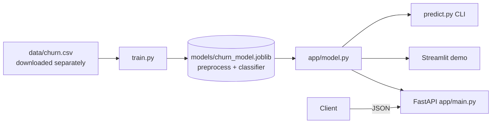

# Customer Churn API

A model that predicts whether a bank customer is about to leave, served through a FastAPI REST API.
It covers the full path from a trained model to a running service: training script, input validation,
tests, Docker image, CI and a small Streamlit demo.

Russian version: [README.ru.md](README.ru.md)

*Portfolio project (Data Science program, Netology).*

## Problem

Banks lose money when customers leave, and winning a customer back costs more than keeping one.
Given a customer's profile (age, country, balance, number of products and so on), the service returns
the probability of churn and a risk level (`low` / `medium` / `high`), so a retention team knows whom to call first.

## Results

Dataset: 10,000 customers, 20.4% churned ([Kaggle Churn Modelling](https://www.kaggle.com/datasets/shrutimechlearn/churn-modelling), licence unknown, so the file is not in this repository; see `data/README.md`).
All numbers below come from running `python train.py` on the full dataset
(`random_state=42`, stratified 80/20 split, 5-fold stratified CV on the full data).
CI and the tests use a small synthetic fixture instead, so CI metrics are not comparable to this table.

| Metric | Value |
|---|---|
| ROC-AUC, holdout (2,000 rows) | **0.8674** |
| ROC-AUC, 5-fold CV | **0.8669** +/- 0.0063 |

Model: `HistGradientBoostingClassifier` behind a one-hot encoding step, saved as a single sklearn `Pipeline`.
I did not tune the decision threshold (0.5) or compare against other model families, so treat this as a solid baseline.

Python 3.12+. Last run locally on Python 3.14 with scikit-learn 1.9.1, pandas 3.0.6, FastAPI 0.143.1, pydantic 2.14.1.

## Stack

Python, scikit-learn, pandas, FastAPI, Pydantic, Uvicorn, pytest, Docker, GitHub Actions, Streamlit.

## Architecture



Preprocessing is part of the saved pipeline, so the API sends raw fields to the model and there is no
separate preprocessing code that could drift away from training. The model is loaded once on startup;
if the artifact is missing the service still starts, `/health` reports `degraded` and `/predict` returns 503.

## Quickstart

### Local

```bash
python3 -m venv .venv && source .venv/bin/activate
pip install -r requirements-dev.txt

scripts/download_data.sh             # full dataset from Kaggle into data/churn.csv (needs Kaggle CLI + token)
python train.py                      # writes models/churn_model.joblib and models/metrics.json
# no Kaggle account? train on the synthetic fixture: python train.py --data tests/fixtures/churn_sample.csv
uvicorn app.main:app --reload        # http://localhost:8000/docs

pytest -q                            # tests (if no model exists, trains one on data/churn.csv or the fixture)
streamlit run streamlit_app.py       # optional demo UI
python predict.py --csv data/churn.csv --limit 5   # offline predictions (needs the full dataset)
python predict.py --json '{...one customer...}'    # validated with the same schema as the API
```

### Docker

The model is trained while the image is built, so the container is self-contained. If `data/churn.csv` is absent
(for example in CI), it is trained on the synthetic fixture, which is fine for a smoke test but not for real use.
The container runs as a non-root user.

```bash
docker build -t churn-api .
docker run -p 8000:8000 churn-api
# http://localhost:8000/docs
```

The container listens on `$PORT` (default 8000), so the same image works on Render or Railway.
Docker image is built in CI on every push.

## API

| Method | Path | Description |
|---|---|---|
| GET | `/health` | Service status, whether the model is loaded, model ROC-AUC |
| POST | `/predict` | One customer |
| POST | `/predict/batch` | 1 to 1000 customers |
| GET | `/docs` | Swagger UI |

Request:

```bash
curl -X POST http://localhost:8000/predict \
  -H "Content-Type: application/json" \
  -d '{"CreditScore":600,"Geography":"Germany","Gender":"Female","Age":58,
       "Tenure":2,"Balance":120000,"NumOfProducts":1,"HasCrCard":1,
       "IsActiveMember":0,"EstimatedSalary":90000}'
```

Response:

```json
{"churn_probability": 0.9706, "churn": true, "risk_level": "high"}
```

A different customer (`CreditScore` 650, France, age 42, two products, active) gets
`{"churn_probability": 0.0857, "churn": false, "risk_level": "low"}`.

Invalid input is rejected with HTTP 422, for example `Age: 5` (allowed range is 18 to 100), `Geography: "Mars"`, a missing field or an unknown extra field.
Risk levels: below 0.30 is `low`, 0.30 to 0.60 is `medium`, 0.60 and above is `high`.

## Repository structure

```
customer-churn-api/
├── app/
│   ├── main.py            # FastAPI app: endpoints, request logging, error handlers
│   ├── model.py           # model loading and inference
│   └── schemas.py         # Pydantic request/response schemas
├── data/
│   ├── README.md          # dataset source, licence, how to download
│   └── .gitkeep           # churn.csv goes here (git-ignored)
├── scripts/
│   ├── download_data.sh   # fetch the dataset from Kaggle
│   └── make_fixture.py    # generate the synthetic test CSV
├── tests/
│   ├── conftest.py        # trains a model if none exists
│   ├── fixtures/          # synthetic 200-row CSV for tests and CI
│   └── test_api.py
├── train.py               # training and evaluation
├── predict.py             # offline CLI predictions
├── streamlit_app.py       # demo UI
├── Dockerfile
├── requirements.txt
├── requirements-dev.txt
└── .github/workflows/ci.yml
```

## Deploying

Any platform that builds a Dockerfile works. On Render: New, Web Service, point it at the repository and
choose Docker. No extra settings are needed because the image reads `$PORT`.

## Limitations and next steps

- Only one model family and a fixed 0.5 threshold. Choosing the threshold from the cost of a missed churner versus a wasted offer would be more useful.
- No hyperparameter search and no feature engineering. Interaction features (for example age times number of products) and LightGBM or CatBoost are the obvious things to try.
- No probability calibration and no explanations (SHAP) for individual predictions.
- No authentication, rate limiting or request metrics on the API.
- The dataset is public and synthetic-looking; results on real bank data will differ. Its licence is unknown, see `data/README.md`.
- CI trains on a 200-row synthetic fixture, so it checks that the code works, not model quality.

## License

Code: MIT, see [LICENSE](LICENSE). The dataset is not part of this repository and is not covered by it, see `data/README.md`.
