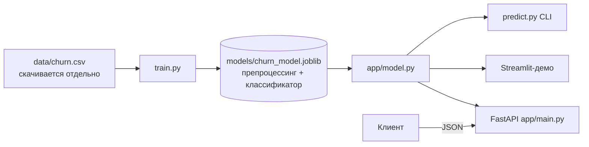

# Customer Churn API

Модель, которая предсказывает, уйдёт ли клиент банка, и REST API на FastAPI вокруг неё.
Здесь весь путь от обученной модели до работающего сервиса: скрипт обучения, валидация входа, тесты,
Docker-образ, CI и небольшое демо на Streamlit.

English version: [README.md](README.md)

*Проект портфолио (программа Data Scientist, Нетология).*

## Задача

Банк теряет деньги, когда клиенты уходят, а вернуть клиента дороже, чем удержать. По профилю клиента
(возраст, страна, баланс, число продуктов и т. д.) сервис возвращает вероятность оттока и уровень риска
(`low` / `medium` / `high`), чтобы отдел удержания знал, кому звонить в первую очередь.

## Результаты

Данные: 10 000 клиентов, 20,4% ушли ([Kaggle Churn Modelling](https://www.kaggle.com/datasets/shrutimechlearn/churn-modelling), лицензия не указана, поэтому файла в репозитории нет, см. `data/README.md`).
Все цифры получены запуском `python train.py` на полном датасете
(`random_state=42`, стратифицированное разбиение 80/20 и 5-кратная стратифицированная CV на всех данных).
CI и тесты работают на небольшом синтетическом файле, так что метрики в CI с этой таблицей сравнивать нельзя.

| Метрика | Значение |
|---|---|
| ROC-AUC, отложенная выборка (2 000 строк) | **0.8674** |
| ROC-AUC, 5-fold CV | **0.8669** +/- 0.0063 |

Модель: `HistGradientBoostingClassifier` с one-hot кодированием, сохранена как один `Pipeline` sklearn.
Порог (0.5) не подбирался и другие семейства моделей не сравнивались, так что это крепкий бейзлайн, не больше.

Python 3.12+. Последний локальный запуск: Python 3.14, scikit-learn 1.9.1, pandas 3.0.6, FastAPI 0.143.1, pydantic 2.14.1.

## Стек

Python, scikit-learn, pandas, FastAPI, Pydantic, Uvicorn, pytest, Docker, GitHub Actions, Streamlit.

## Архитектура



Препроцессинг входит в сохранённый пайплайн: API передаёт в модель сырые поля, и отдельного кода подготовки,
который мог бы разойтись с обучением, нет. Модель загружается один раз при старте. Если артефакта нет,
сервис всё равно запускается, `/health` показывает `degraded`, а `/predict` отвечает 503.

## Быстрый старт

### Локально

```bash
python3 -m venv .venv && source .venv/bin/activate
pip install -r requirements-dev.txt

scripts/download_data.sh             # полный датасет с Kaggle в data/churn.csv (нужны Kaggle CLI и токен)
python train.py                      # создаёт models/churn_model.joblib и models/metrics.json
# нет аккаунта Kaggle? обучите на синтетике: python train.py --data tests/fixtures/churn_sample.csv
uvicorn app.main:app --reload        # http://localhost:8000/docs

pytest -q                            # тесты (если модели нет, она обучится на data/churn.csv или на синтетике)
streamlit run streamlit_app.py       # демо-интерфейс
python predict.py --csv data/churn.csv --limit 5   # офлайн-предсказания (нужен полный датасет)
python predict.py --json '{...один клиент...}'     # проверяется той же схемой, что и в API
```

### Docker

Модель обучается при сборке образа, поэтому контейнер самодостаточный. Если `data/churn.csv` нет
(например, в CI), она обучается на синтетическом файле: для проверки сборки сойдёт, для реального использования нет.
Контейнер работает не от root.

```bash
docker build -t churn-api .
docker run -p 8000:8000 churn-api
# http://localhost:8000/docs
```

Контейнер слушает `$PORT` (по умолчанию 8000), так что образ подходит для Render и Railway.
Docker-образ собирается в CI при каждом push.

## API

| Метод | Путь | Описание |
|---|---|---|
| GET | `/health` | Статус сервиса, загружена ли модель, ROC-AUC модели |
| POST | `/predict` | Один клиент |
| POST | `/predict/batch` | От 1 до 1000 клиентов |
| GET | `/docs` | Swagger UI |

Запрос:

```bash
curl -X POST http://localhost:8000/predict \
  -H "Content-Type: application/json" \
  -d '{"CreditScore":600,"Geography":"Germany","Gender":"Female","Age":58,
       "Tenure":2,"Balance":120000,"NumOfProducts":1,"HasCrCard":1,
       "IsActiveMember":0,"EstimatedSalary":90000}'
```

Ответ:

```json
{"churn_probability": 0.9706, "churn": true, "risk_level": "high"}
```

Другой клиент (`CreditScore` 650, Франция, 42 года, два продукта, активный) получает
`{"churn_probability": 0.0857, "churn": false, "risk_level": "low"}`.

Некорректный вход отклоняется с HTTP 422, например `Age: 5` (допустимо от 18 до 100), `Geography: "Mars"`, пропущенное поле или лишнее поле.
Уровни риска: меньше 0.30 это `low`, от 0.30 до 0.60 это `medium`, от 0.60 это `high`.

## Структура репозитория

```
customer-churn-api/
├── app/
│   ├── main.py            # FastAPI: эндпоинты, логирование запросов, обработчики ошибок
│   ├── model.py           # загрузка модели и инференс
│   └── schemas.py         # Pydantic-схемы запросов и ответов
├── data/
│   ├── README.md          # источник данных, лицензия, как скачать
│   └── .gitkeep           # сюда кладётся churn.csv (в git не попадает)
├── scripts/
│   ├── download_data.sh   # скачать датасет с Kaggle
│   └── make_fixture.py    # сгенерировать синтетический CSV для тестов
├── tests/
│   ├── conftest.py        # обучает модель, если её нет
│   ├── fixtures/          # синтетический CSV на 200 строк для тестов и CI
│   └── test_api.py
├── train.py               # обучение и оценка
├── predict.py             # офлайн-предсказания из консоли
├── streamlit_app.py       # демо-интерфейс
├── Dockerfile
├── requirements.txt
├── requirements-dev.txt
└── .github/workflows/ci.yml
```

## Деплой

Подойдёт любая платформа, которая собирает Dockerfile. На Render: New, Web Service, указать репозиторий,
выбрать Docker. Больше ничего настраивать не нужно, образ читает `$PORT`.

## Ограничения и что улучшить

- Одно семейство моделей и фиксированный порог 0.5. Порог лучше выбирать по стоимости пропущенного ушедшего клиента против лишнего предложения.
- Нет подбора гиперпараметров и feature engineering. Первое, что стоит попробовать: взаимодействия признаков (например, возраст на число продуктов), LightGBM или CatBoost.
- Нет калибровки вероятностей и объяснений (SHAP) по отдельным предсказаниям.
- У API нет аутентификации, ограничения частоты запросов и метрик.
- Датасет публичный и выглядит синтетическим; на реальных данных банка результат будет другим. Лицензия неизвестна, см. `data/README.md`.
- CI обучает модель на синтетике из 200 строк, так что он проверяет работу кода, а не качество модели.

## Лицензия

Код: MIT, см. [LICENSE](LICENSE). Датасета в репозитории нет, и эта лицензия на него не распространяется, см. `data/README.md`.
